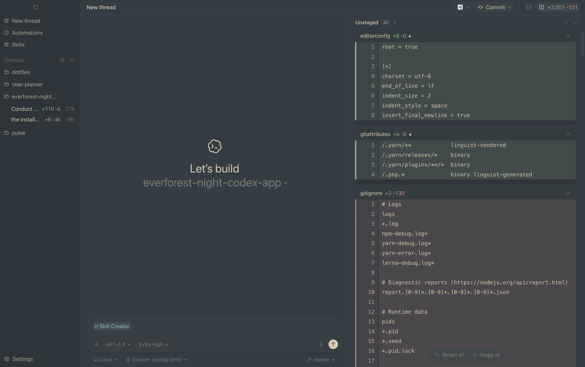
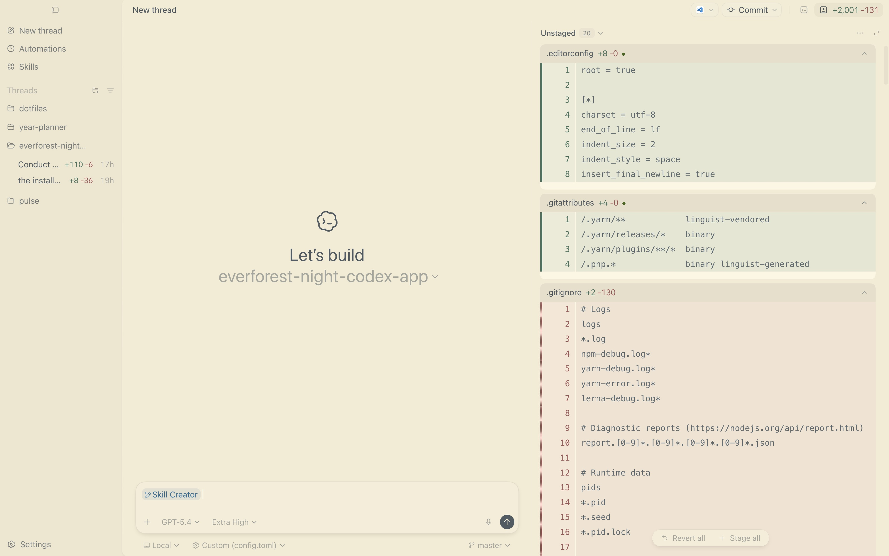

# 🌲 Everforest Night for Codex App

A green-based theme for Codex App, designed to stay warm and readable during long coding sessions

### Everforest Night Dark



### Everforest Night Light



## Installation

### Dark theme

1. Open **Settings** → **Appearance**.
2. Switch the toggler to **Dark**.
3. Pick **Everforest**.
4. Click **Import** and paste the following string:

```
codex-theme-v1:{"codeThemeId":"everforest","variant":"dark","theme":{"accent":"#a7c080","surface":"#323d43","ink":"#d8caac","contrast":42,"opaqueWindows":true,"semanticColors":{"diffAdded":"#7eb18c","diffRemoved":"#d09a8e","skill":"#86bfb7"},"fonts":{"ui":null,"code":null}}}
```

### Light theme

1. Open **Settings** → **Appearance**.
2. Switch the toggler to **Light**.
3. Pick **Everforest**.
4. Click **Import** and paste the following string:

```
codex-theme-v1:{"codeThemeId":"everforest","variant":"light","theme":{"accent":"#47661b","surface":"#f3ebd2","ink":"#4f5b62","contrast":38,"opaqueWindows":true,"semanticColors":{"diffAdded":"#46725d","diffRemoved":"#9c5656","skill":"#2e7099"},"fonts":{"ui":null,"code":null}}}
```

## Color Palette

### Dark

| Token        | Hex       | Preview                                                       |
| ------------ | --------- | ------------------------------------------------------------- |
| Accent       | `#a7c080` |  |
| Surface      | `#323d43` |  |
| Ink          | `#d8caac` |  |
| Diff Added   | `#7eb18c` |  |
| Diff Removed | `#d09a8e` |  |
| Skill        | `#86bfb7` |  |

### Light

| Token        | Hex       | Preview                                                       |
| ------------ | --------- | ------------------------------------------------------------- |
| Accent       | `#47661b` |  |
| Surface      | `#f3ebd2` |  |
| Ink          | `#4f5b62` |  |
| Diff Added   | `#46725d` |  |
| Diff Removed | `#9c5656` |  |
| Skill        | `#2e7099` |  |

## Build locally

### Requirements

- Node `24.9.0`
- Yarn `4.10.3`

### Install

```sh
yarn install
```

### Compile

```sh
yarn build
```

It writes the artifacts to `dist/`:

- `dist/everforest-night-dark.txt`
- `dist/everforest-night-light.txt`
- `dist/manifest.json`

## Acknowledgments

Inspired by [Forest Night](https://github.com/jef/forest-night-jetbrains) by [@jef](https://github.com/jef) and [Everforest](https://github.com/sainnhe/everforest-vscode) by [@sainnhe](https://github.com/sainnhe)

## License

[MIT](LICENSE)
